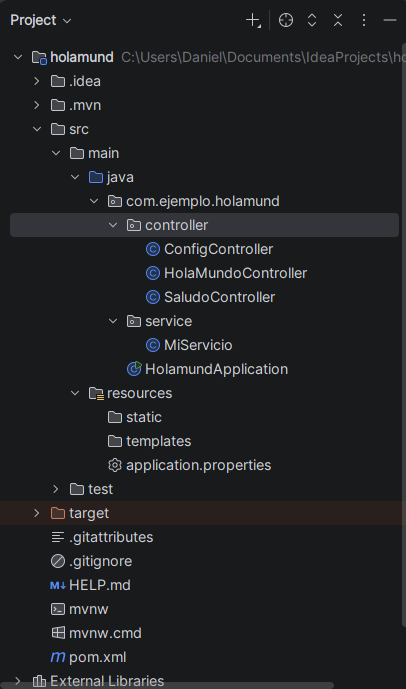
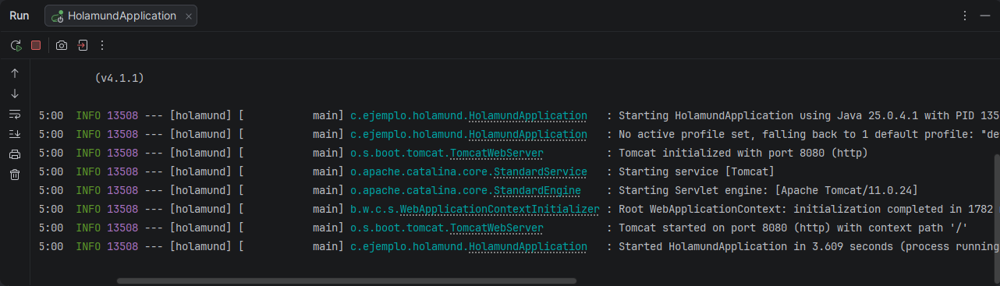
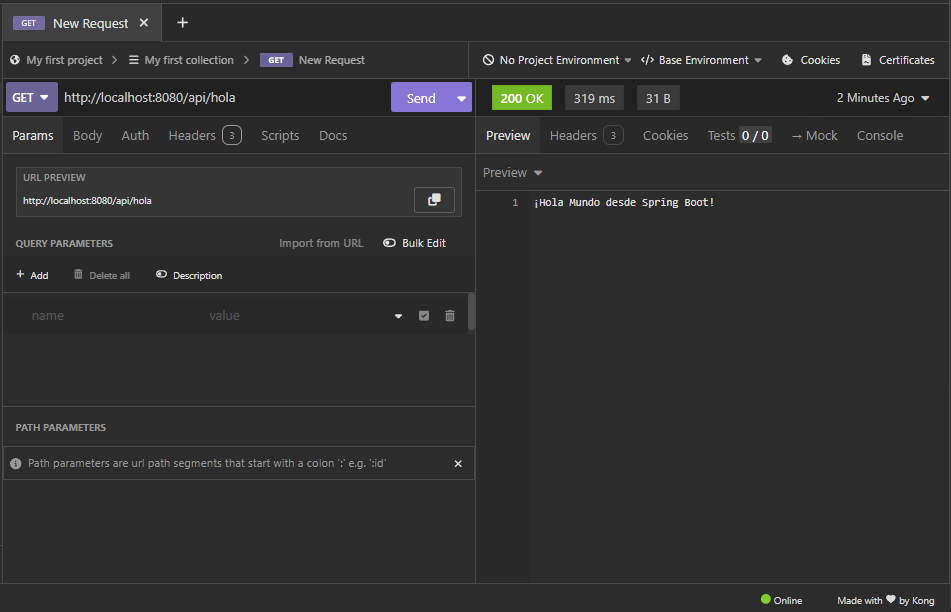
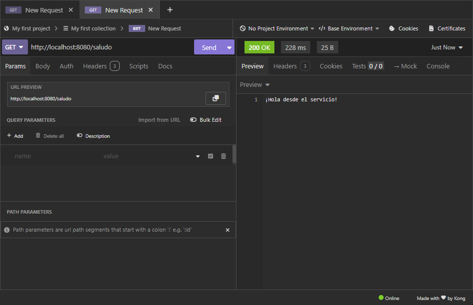
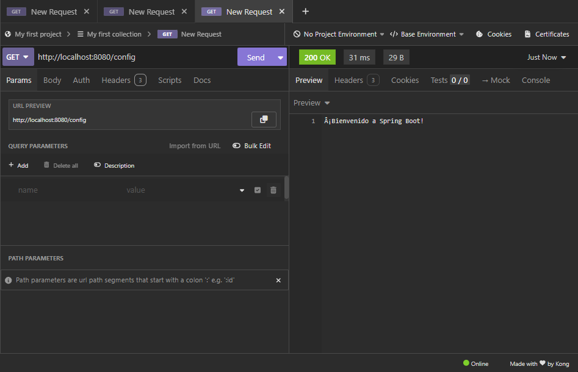
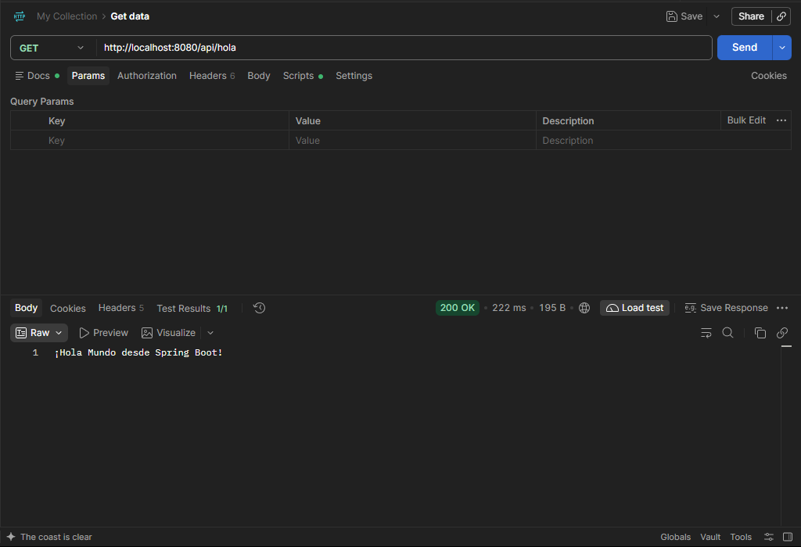
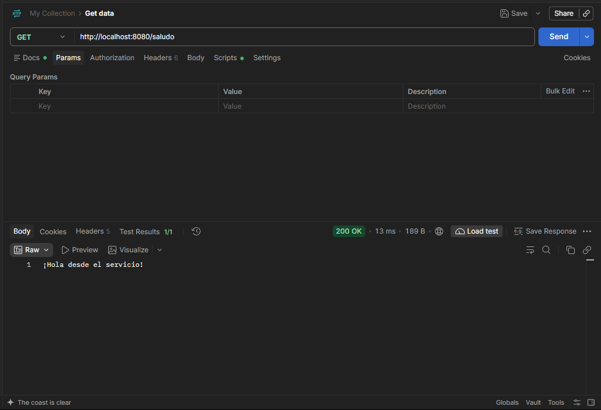
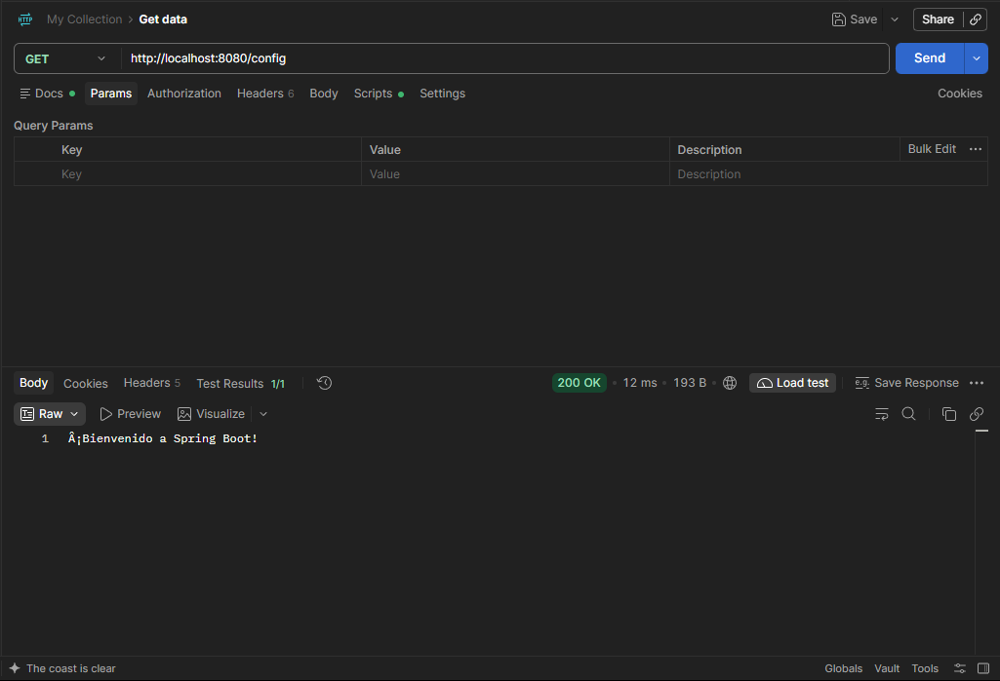
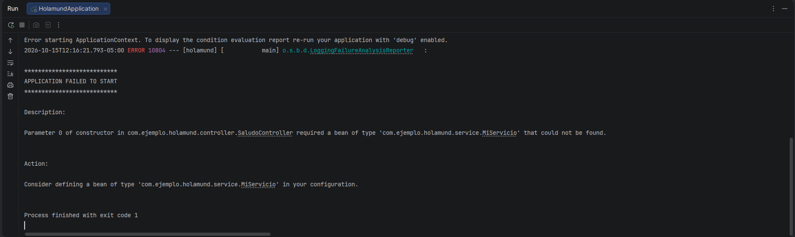
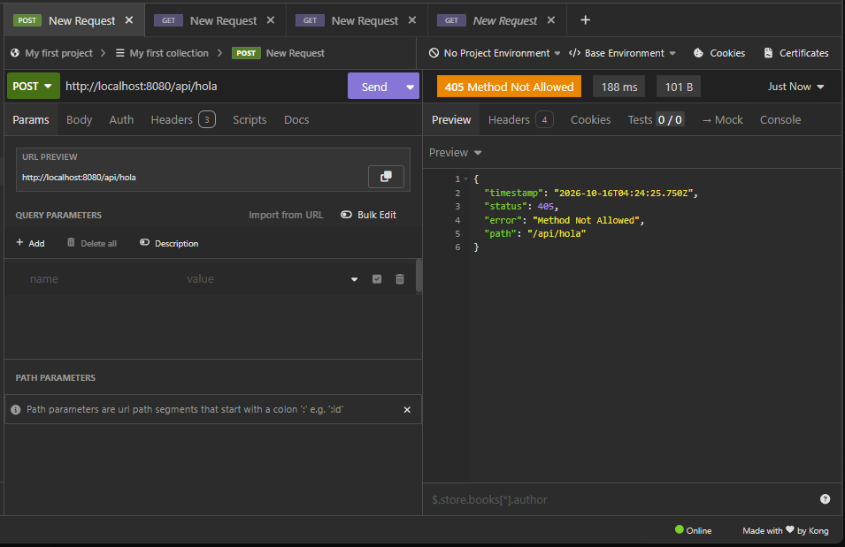

# Mi primer proyecto con Spring Boot: `holamund`

[](https://deepwiki.com/TU_USUARIO/TU_REPOSITORIO)

Actividad práctica en la que se crea, ejecuta y prueba una aplicación **Spring Boot** con tres endpoints REST, aplicando controladores, servicios, inyección de dependencias y configuración externa.

**Autor:** Daniel José Sierra Ricaurte

---

## Tecnologías

| Herramienta | Versión |
|---|---|
| Java (JDK) | 25 |
| Spring Boot | 4.1.1 |
| Servidor embebido | Apache Tomcat 11.0.24 |
| Gestor de dependencias | Maven |
| IDE | IntelliJ IDEA |
| Cliente HTTP | Insomnia y Postman |
| Dependencia | Spring Web |

## Estructura del proyecto

```
src/main/java/com/ejemplo/holamund/
├── HolamundApplication.java
├── controller/
│   ├── HolaMundoController.java
│   ├── SaludoController.java
│   └── ConfigController.java
└── service/
    └── MiServicio.java
src/main/resources/
└── application.properties
```



## Cómo ejecutar el proyecto

1. Clona el repositorio:
   ```bash
   git clone 
   ```
2. Ábrelo en IntelliJ IDEA (**File > Open** y selecciona el `pom.xml`).
3. Espera a que Maven termine de descargar las dependencias.
4. Ejecuta `HolamundApplication` con el botón **▶**.
5. Cuando la consola muestre `Tomcat started on port 8080`, la aplicación está lista.

También puedes ejecutarla desde la terminal:

```bash
./mvnw spring-boot:run
```

### Servidor iniciado correctamente



## Endpoints

| Método | Endpoint | Descripción | Respuesta esperada |
|---|---|---|---|
| GET | `/api/hola` | Controlador básico "Hola Mundo" | ¡Hola Mundo desde Spring Boot! |
| GET | `/saludo` | Usa un servicio inyectado (`MiServicio`) | ¡Hola desde el servicio! |
| GET | `/config` | Lee una propiedad de `application.properties` con `@Value` | ¡Bienvenido a Spring Boot! |

## Pruebas con Insomnia

### `GET /api/hola`


### `GET /saludo`


### `GET /config`


## Pruebas con Postman

### `GET /api/hola`


### `GET /saludo`


### `GET /config`


## Retos

### Reto 1: ¿Para qué sirve `@Service`?

Al comentar la anotación `@Service` en `MiServicio`, la aplicación **no arranca**. Spring no crea el bean `MiServicio`, y `SaludoController` lo necesita en su constructor:

```
Parameter 0 of constructor in SaludoController required a bean
of type 'MiServicio' that could not be found.
```



Al volver a poner `@Service`, la aplicación arranca con normalidad.

### Reto 2: ¿Qué pasa con un método equivocado?

Al enviar un **POST** a `/api/hola`, que solo tiene `@GetMapping`, el servidor responde **405 Method Not Allowed**. La ruta existe, pero no acepta ese método HTTP.



## Pregunta de reflexión

**¿Qué diferencia hay entre `@RestController` y `@Service`, y por qué Spring puede entregar el servicio al controlador sin usar `new`?**

- `@RestController` marca una clase que **atiende peticiones HTTP**. Sus métodos se asocian a rutas (`@GetMapping`, etc.) y lo que retornan se envía directamente como cuerpo de la respuesta.
- `@Service` marca una clase que contiene la **lógica de negocio**. No sabe nada de HTTP: solo ofrece operaciones que otras clases pueden usar.
- Ambas anotaciones registran la clase como un **bean** dentro del contenedor de Spring. Al arrancar, Spring escanea el paquete, crea esos objetos y los guarda. Cuando el controlador declara `MiServicio` en su constructor, Spring busca el bean en el contenedor y se lo entrega. Esto se llama **inyección de dependencias**, y por eso el controlador nunca necesita usar `new`. Además, si el bean no existe (como en el Reto 1), la aplicación falla al iniciar en lugar de fallar más tarde.

## Código principal

<details>
<summary>HolaMundoController</summary>

```java
@RestController
@RequestMapping("/api")
public class HolaMundoController {

    @GetMapping("/hola")
    public String holaMundo() {
        return "¡Hola Mundo desde Spring Boot!";
    }
}
```
</details>

<details>
<summary>MiServicio y SaludoController</summary>

```java
@Service
public class MiServicio {
    public String obtenerSaludo() {
        return "¡Hola desde el servicio!";
    }
}
```

```java
@RestController
@RequestMapping("/saludo")
public class SaludoController {

    private final MiServicio miServicio;

    @Autowired
    public SaludoController(MiServicio miServicio) {
        this.miServicio = miServicio;
    }

    @GetMapping
    public String mostrarSaludo() {
        return miServicio.obtenerSaludo();
    }
}
```
</details>

<details>
<summary>ConfigController y application.properties</summary>

```properties
mensaje.bienvenida=¡Bienvenido a Spring Boot!
```

```java
@RestController
@RequestMapping("/config")
public class ConfigController {

    @Value("${mensaje.bienvenida}")
    private String mensaje;

    @GetMapping
    public String obtenerMensaje() {
        return mensaje;
    }
}
```
</details>
